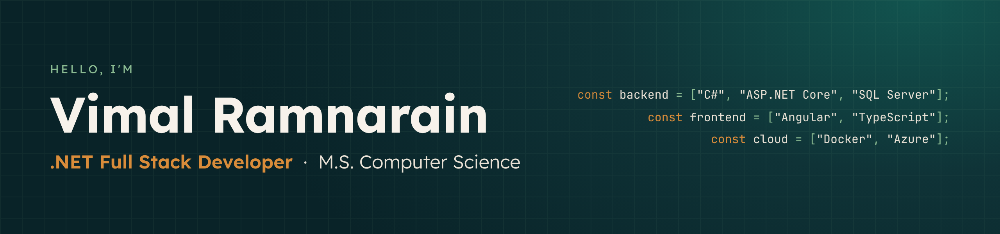
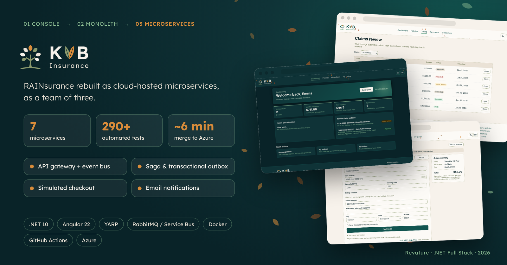
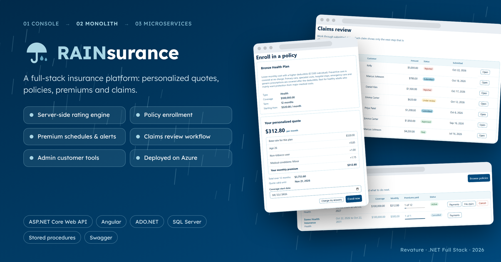
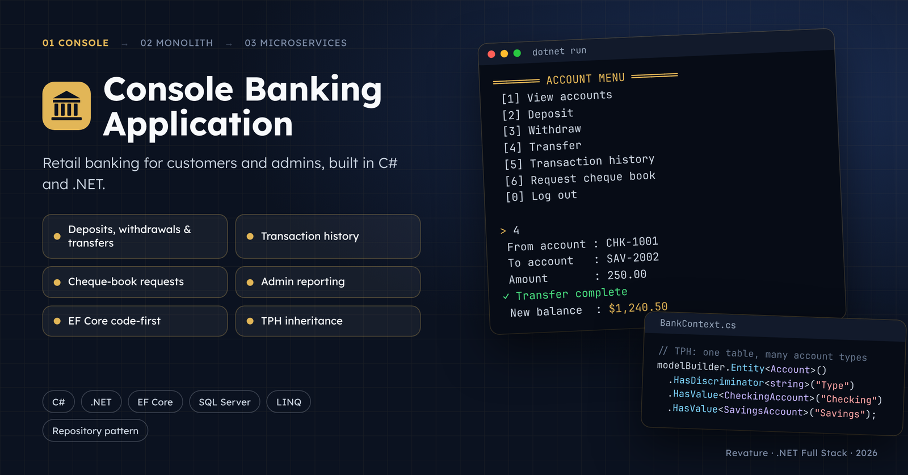
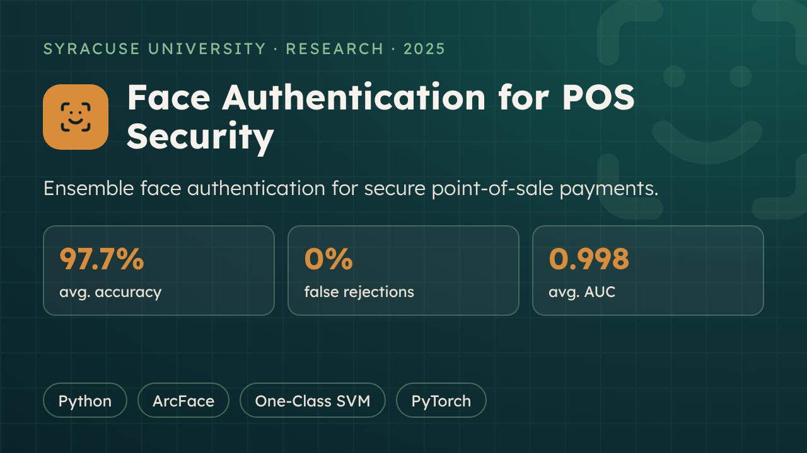
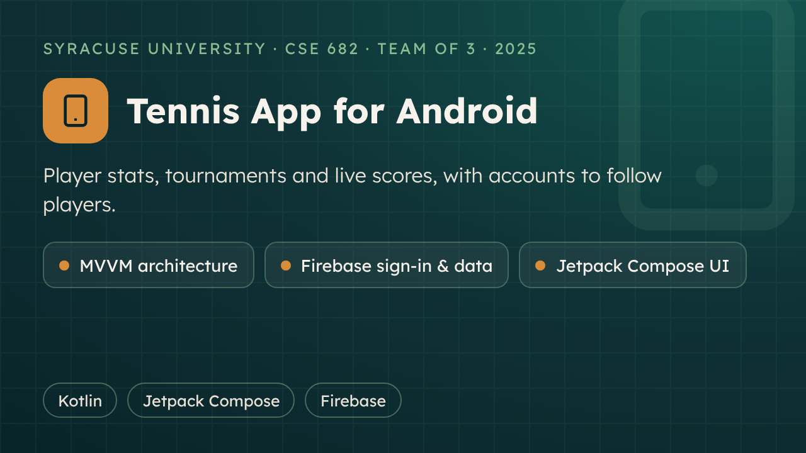
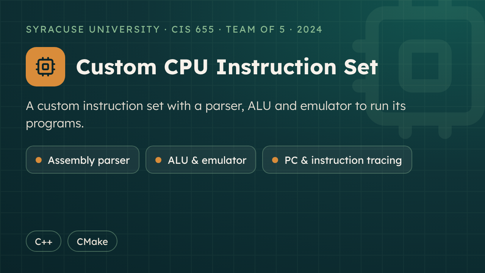
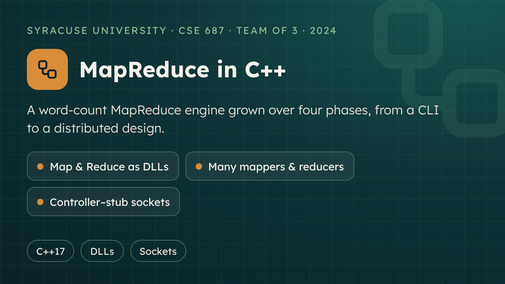

  
  
  

## About Me

I'm a **.NET Full Stack Developer** who builds web applications end to end: from the database and the API to the browser and the cloud. I hold an **M.S. in Computer Science** from Syracuse University and a **B.S. in Biology** with a minor in Mathematics. For a quick tour, visit my [portfolio](https://organizedanvrchy.github.io/portfolioSPA/).

<table>
  <tr>
    <td width="200"><b>Core Stack</b></td>
    <td>
      
      
      
      
      
      
      
      
      
      
    </td>
  </tr>
  <tr>
    <td><b>Also Experienced With</b></td>
    <td>
      
      
      
      
      
    </td>
  </tr>
  <tr>
    <td><b>Interests</b></td>
    <td>Programming, video games, mechanical keyboards, gardening, construction, and tennis / table tennis</td>
  </tr>
</table>

## Experience & Education

### Revature
**.NET Full Stack Developer** · 2026

Building enterprise-style applications with C#, ASP.NET Core, Angular and SQL Server, from a console application to a monolith to cloud-hosted microservices.

**[KVB Insurance](https://github.com/organizedanvrchy/Insurance-Full-Stack-App-MSA)** · Team of 3 · [Live site](https://salmon-grass-0f7ae9d1e.6.azurestaticapps.net) 
RAINsurance rebuilt as 7 microservices behind an API gateway, with an event bus, a saga and transactional outbox, a simulated checkout, email notifications, and CI/CD to Azure.

<table>
  <tr>
    <td width="50%" valign="top">
      
      <b><a href="https://github.com/organizedanvrchy/Insurance-Full-Stack-App">RAINsurance</a></b> 
      Full-stack insurance platform: personalized quotes, policies, premium schedules and claims review.
    </td>
    <td width="50%" valign="top">
      
      <b><a href="https://github.com/organizedanvrchy/project1.1">Console Banking Application</a></b> 
      Retail banking for customers and admins, with EF Core code-first and TPH inheritance.
    </td>
  </tr>
</table>

### Syracuse University
**M.S. Computer Science** · College of Engineering and Computer Science · 2023 – 2025

| Area | Coursework |
|---|---|
| Foundations | Programming & Data Structures · Design & Analysis of Algorithms |
| Software | Object-Oriented Design · Software Engineering · Assured Programming & Formal Methods |
| Systems | Advanced Computer Architecture · Principles of Operating Systems |
| Security & ML | Computer Security · Cryptography · Biometrics · Machine Learning for Security |

<table>
  <tr>
    <td width="50%" valign="top">
      
      <b><a href="https://github.com/organizedanvrchy/Face-Authentication-for-POS-Systems">Face Authentication for POS Security</a></b> 
      ArcFace embeddings with a One-Class SVM and neural network ensemble, hardened by data augmentation.
    </td>
    <td width="50%" valign="top">
      
      <b><a href="https://github.com/organizedanvrchy/TennisAppDemo-Android-">Tennis App for Android</a></b> 
      Player and tournament statistics in Kotlin and Jetpack Compose, with Firebase accounts.
    </td>
  </tr>
  <tr>
    <td width="50%" valign="top">
      
      <b><a href="https://github.com/organizedanvrchy/cis-655-instruction-set">Custom CPU Instruction Set</a></b> 
      A C++ parser, ALU and emulator for a custom instruction set.
    </td>
    <td width="50%" valign="top">
      
      <b><a href="https://github.com/organizedanvrchy/Object-Oriented-Design-Project">MapReduce in C++</a></b> 
      A word-count MapReduce engine built in four phases, from a CLI to a controller–stub design.
    </td>
  </tr>
</table>

Course notes and assignments: [SU-CIS-CSE](https://github.com/organizedanvrchy/SU-CIS-CSE)

### CUNY York College
**B.S. Biology**, minor in Mathematics · 2015 – 2019

### Amazon CodePath
**[TIP103: Advanced Technical Interview Prep](https://github.com/organizedanvrchy/CodePath/tree/main/TIP103#table-of-contents)** · Fall 2024

## More Projects

Systems projects and small apps

 

| Project | Language | Year |
|---|---|:---:|
| [RainOS](https://github.com/organizedanvrchy/rain_os) | Rust | 2025 |
| [Rainy UNIX Shell](https://github.com/organizedanvrchy/rainy_shell) | C | 2025 |
| [Simple Text Editor](https://github.com/organizedanvrchy/Text-Editor-Python) | Python | 2025 |
| [Simple Regex Parser](https://github.com/organizedanvrchy/Regex-Parser-Python) | Python | 2025 |
| [YouTube Clone](https://github.com/organizedanvrchy/Youtube-Clone) | TypeScript | 2025 |
| [Tic-Tac-Toe](https://github.com/organizedanvrchy/TicTacToe) | C | 2025 |
| [Snake](https://github.com/organizedanvrchy/TicTacToe) | Python | 2025 |
| [Pong](https://github.com/organizedanvrchy/Pong) | Python | 2025 |
| [Chess with an AI Opponent](https://github.com/organizedanvrchy/Chess) | Python | 2025 |

[All projects](https://github.com/organizedanvrchy/Projects)

